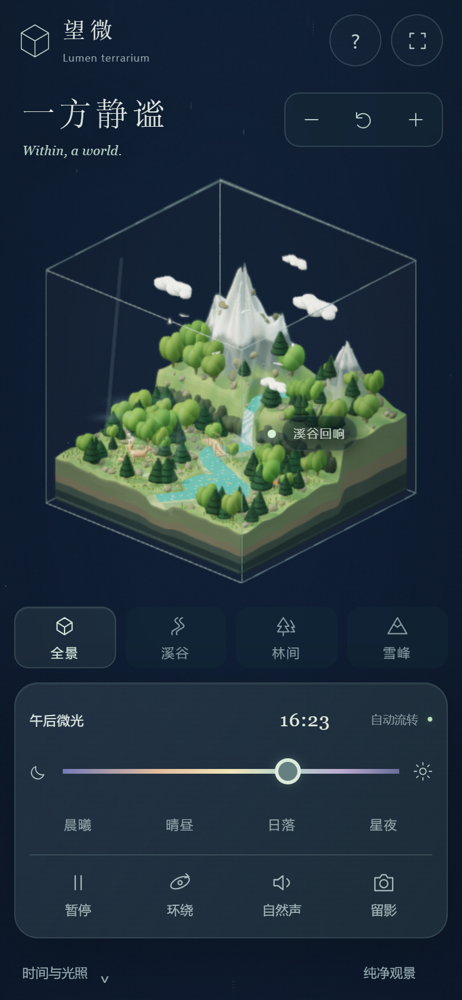
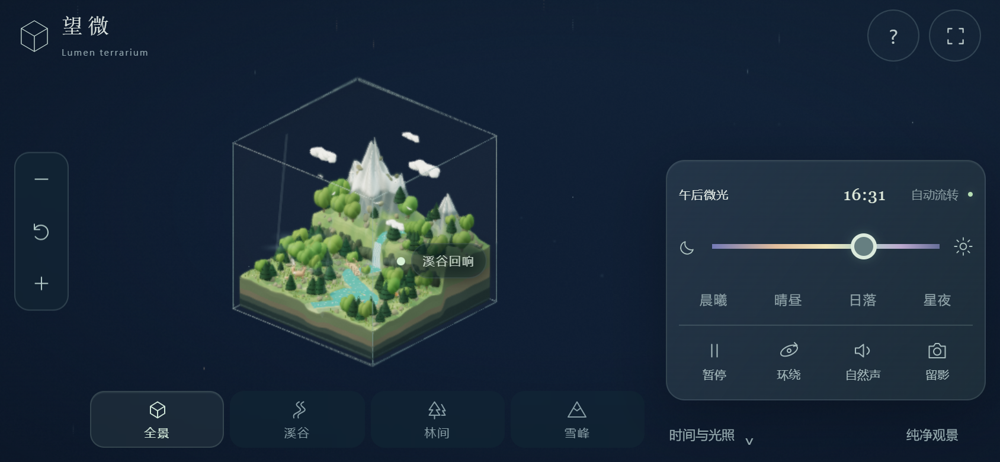

# 一方静谧 · Lumen terrarium

一枚悬浮在深空中的玻璃生态立方体。雪山、森林、河流、瀑布与湖泊，在缓慢流转的昼夜里呼吸。

**[打开在线世界](https://yjj0339.github.io/lumen-terrarium/)**

完全静态的 Three.js 场景，支持电脑、手机与平板。没有账号、广告、分析脚本或外部素材请求。

## 手机操作



- **单指拖动**旋转，**双指捏合**缩放；也可使用 **＋、−、复位**按钮。
- **全景 / 溪谷 / 林间 / 雪峰**，一键改变观察视角。
- **时间与光照**可展开或收起面板。小屏默认收起，为场景留下空间。
- 时间滑杆与**晨曦 / 晴昼 / 日落 / 星夜**控制光照；**自动流转**开启昼夜循环。
- **暂停、环绕、自然声、留影**始终可触达。按钮触控区域至少为 44×44 CSS 像素。
- **留影**会打开照片预览，可下载、长按保存；浏览器支持时可调用系统分享。
- **纯净观景**隐藏界面，屏幕上始终保留“返回操作”。不支持网页全屏的浏览器自动使用沉浸观景。
- 横屏时控制面板移到右侧。支持安全区域、动态视口高度和浏览器地址栏尺寸变化。



## 桌面操作

拖动旋转、滚轮缩放。快捷键：`Space` 暂停 / 继续，`H` 纯净观景，`R` 复位，`P` 留影。点击光点可以阅读生态介绍并靠近观察。

## 场景内容

程序化雪山与分层岩土、130 棵树、草丛与花卉、蜿蜒河流、动态瀑布、水雾、湖泊睡莲和木桥。15 只微型动物包括鹿、兔子、狐狸、水鸟与飞鸟。正交镜头、透射玻璃、物理材质、阴影、光束散射近似、轻微辉光、移轴模糊与抗锯齿共同构成桌面微缩摆件质感。

夜晚可看到冷色月光与萤火。自然声由程序合成，需要主动点击开启。系统开启“减少动态效果”时，世界默认暂停且自动昼夜关闭。

## 离线打开

下载 **`一方静谧-直接打开.html`**，直接用支持 WebGL 2 的现代浏览器打开。依赖、材质与代码已内嵌，运行时不需要网络或服务器。

## 本地开发

需要 Node.js 20 或更新版本。

```sh
npm install
npm run build
npm start
```

打开 `http://127.0.0.1:4207/`。本地预览服务器仅监听本机，电脑端留影会写入 `exports/`；GitHub Pages 版本在浏览器中导出图片，不调用本地截图接口。

`npm run build` 使用 esbuild 0.25.12，生成 `bundle.js` 和独立离线 HTML。已安装 esbuild 可执行文件时，也可通过 `ESBUILD_BINARY_PATH` 指定其路径。

| 文件 | 用途 |
| --- | --- |
| `index.html` / `style.css` | 页面与触控响应式布局 |
| `world.js` | 地形、生态、材质、光照与动画 |
| `app.js` | 镜头、触控、后期、声音、截图与界面 |
| `vendor/` | Three.js 0.179.1 及实际使用的模块 |
| `build.mjs` / `server.mjs` | 构建与本地预览 |

GitHub Pages 从 `main` 分支根目录发布。渲染性能依设备与分辨率变化，触屏设备会自动限制渲染像素比和阴影分辨率。手机检查使用浏览器设备模拟与真实触控事件派发，不代表所有实体手机浏览器均已实机测试。

## 许可

本项目使用 [MIT License](LICENSE)。Three.js 及其模块的许可证见 [vendor/THREE-LICENSE.txt](vendor/THREE-LICENSE.txt)。
